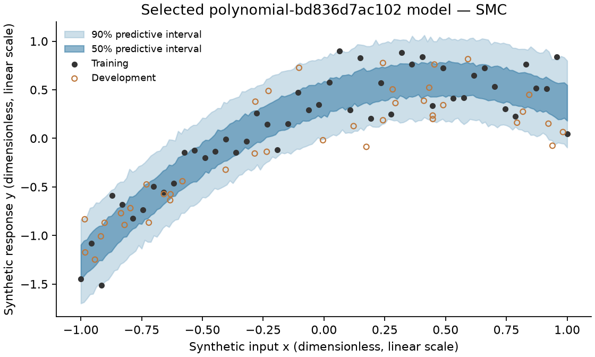

# Completed synthetic autoresearch demonstration

The bounded run completed on 2026-11-13 and stopped. It used real subscription
Codex `gpt-5.6-sol` proposals at high effort and local numerical calibration.
No NHP work or cluster jobs were started.

## What happened

The starting model was linear. Codex proposed a quadratic model, then a cubic
alternative, then independently proposed another quadratic model on another
search island. All proposals passed the trusted model-interface checks.

The search completed four generations including the starting model. The numerical
work comprised four MAP screens, four short MCMC fits, and two SMC confirmations:
**three Codex proposals and ten calibration evaluations**.

The quadratic and cubic structures reached SMC confirmation. The second quadratic
proposal had the same predictive structure as the first. The exploration quota
kept the cubic alternative in confirmation instead of spending both final slots
on quadratic variants.

## Comparable results

Each column uses one calibration protocol and the same development observations.
Values are mean log predictive density, in nats per observation; higher is better.
Comparisons across columns mix inference methods and should not be treated as
model improvements.

| Structure | MAP screen | Short MCMC | SMC confirmation |
| --- | ---: | ---: | ---: |
| Linear | -0.718164 | -0.673964 | Not promoted |
| Quadratic | -0.135718 | -0.132201 | **-0.131567** |
| Cubic | -0.146515 | -0.138377 | -0.140410 |

The quadratic model was selected. Its separate final-test score was **0.016971**,
computed once after freezing selection, without refitting. This tiny synthetic
example demonstrates the workflow; it is not evidence about NHP model performance.

The prediction intervals include parameter and observation uncertainty. Filled
points are training observations; open points are development observations.
The known Gaussian posterior supplies an inference reference for this example.

## What the demonstration taught us

- The simple screening score identified the useful structural change from a
  line to a curve. SMC then compared the two finalists under one protocol.
- Structural exploration retained an alternative even after the quadratic
  model became the leading candidate.
- Two authors independently rediscovered the same quadratic structure. The
  ledger preserves both source histories; the report exposes the duplication.
  Trusted semantic deduplication could save inference work in a later version.
- Public training evidence and versioned steering reached the real author
  prompts. No user-defined hard guidelines were supplied for this demonstration;
  their approval gates were covered by separate integration tests.
- The headless tool printed an API-equivalent estimate of $0.1670. That is not
  an invoice or measured API charge. The worker used verified ChatGPT subscription
  authentication, with no API key configured and no Azure route.

The process exited successfully with four completed generations, zero running
evaluations, and zero active proposals. Further research is stopped pending the
scientist's instructions for the NHP case.

## Reproduce or adapt

See [MODEL_DEVELOPMENT.md](MODEL_DEVELOPMENT.md) for the synthetic launcher and
[REMOTE_EXECUTION.md](REMOTE_EXECUTION.md) for the remote scheduler. The local
numerical demo needs no LLM. A live proposal run needs the intended verified
subscription login and the headless adapter (version 0.6.1 was used here).

The remote implementation passed fake-scheduler/transport tests. Live Gautschi
commissioning remains separate from this local demonstration.
